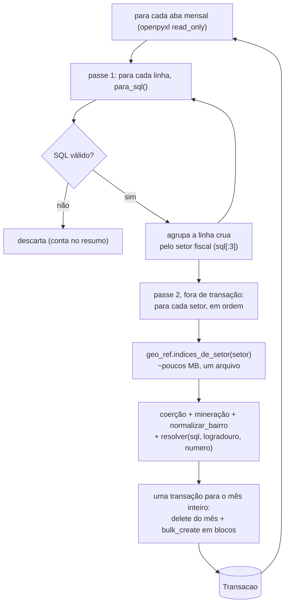
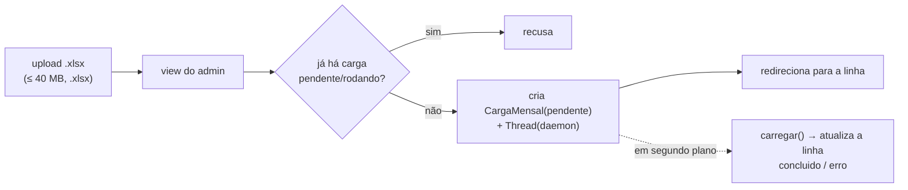

# SERA ATUALIAZADA POS V0

# Comando `carregar_itbi`

`python manage.py carregar_itbi --arquivo <planilha.xlsx>` lê a planilha de guias de
ITBI pagas e grava as transações no banco. É a **entrega demonstrável da fase de
dados**.

Junta as três peças que vêm antes: as funções puras de
[`carga-mineracao.md`](carga-mineracao.md), a
[referência geo versionada](referencia-geo.md) e o [modelo](modelo-transacao.md).
**Sem `pandas`, sem `shapely`.**

---

## Fluxo

A unidade de trabalho é **uma aba — um mês da guia**. Cada aba é lida, minerada e
gravada antes de a próxima começar.

**Por que agrupar por setor:** carregar a referência geo da cidade inteira custa
~450 MB (perto do teto de 600 MB do container). Carregando **um setor por vez**, só
alguns MB ficam residentes. O custo é reabrir os 269 arquivos `.json.gz` uma vez por
aba — **2,5 s por aba**, ~11% do tempo total; para uma carga que roda poucas vezes por
ano, compensa.

**Por que uma aba por vez:** o buffer de linhas cruas é de um mês só (~22 MB nos ~19 mil
registros de um mês típico), então a memória **não cresce com o número de anos** da
planilha. Antes o buffer acumulava todas as abas — 1 190 bytes por linha, ou ~613 MB em
quatro anos, acima do teto do container.

**Por que a transação cobre o mês inteiro:** o `delete` do mês e todos os `bulk_create`
dele são a mesma transação, então **ou o mês é substituído por inteiro, ou o banco fica
como estava**. Morrer no meio — falta de memória, reciclagem do worker do gunicorn,
`docker rm` do deploy — custa no máximo re-executar aquele mês, nunca dado pela metade.

A **mineração fica fora da transação** de propósito: o `transaction_mode` é `IMMEDIATE`,
o lock de escrita é tomado no `BEGIN`, e resolver geo custa ~80% do tempo do mês.
Minerar dentro da transação seguraria o lock esse tempo todo e faria a sessão do admin
tomar `database is locked`. Fora, o lock dura só o delete mais os inserts.

---

## Flags

| Flag                       | Efeito                                                                                           |
| -------------------------- | ------------------------------------------------------------------------------------------------ |
| `--arquivo`                | **obrigatório**, o `.xlsx`                                                                       |
| `--abas JAN-2026,FEV-2026` | só essas abas mensais (padrão: todas)                                                            |
| `--blocos N`               | tamanho do `bulk_create` (padrão 2000)                                                           |
| `--limite N`               | só as N primeiras linhas de cada aba (desenvolvimento). **Recusado** junto com `--substituir-mes` ou `--limpar`: apagaria o mês e reporia só N linhas |
| `--limpar`                 | apaga **tudo** antes. Exclusivo com `--substituir-mes`                                           |
| `--substituir-mes`         | apaga as linhas de cada `ano_guia`+`mes_guia` antes de reinserir — recarregar um mês não duplica. Aba sem linha válida **não** apaga o mês |
| `--sem-geo`                | não resolve `lat`/`lon`/`distrito` (tudo `--`) — feedback rápido                                 |
| `--dry-run`                | parseia, minera e valida sem gravar                                                              |

`carregar(arquivo, abas, ..., progresso=callback)` é uma função separada do
`Command` — é ela que a tela de admin reusa por trás do upload assíncrono (abaixo).

---

## Upload pelo admin

No `/admin/`, **Cargas mensais → Carregar planilha**: envia o `.xlsx` (limite
40 MB), a view salva num arquivo temporário,
cria um registro **`CargaMensal`** e dispara `carregar()` numa `threading.Thread`.
Volta na hora; o progresso (linhas gravadas, `qualidade!=0`, sem geo, pico de
memória) aparece na linha do `CargaMensal`, que é só-leitura.

- **Uma carga por vez.** Uma linha em `rodando` há mais de 2 h conta como morta
  (thread/processo derrubado) e não bloqueia.
- **`--substituir-mes` é o padrão** da tela — reenviar a planilha do mês seguinte
  não duplica os meses já carregados.
- **Sem Celery/Redis.** A `thread` divide o processo do gunicorn; para uma carga que
  roda poucas vezes por ano, com um operador, é aceitável (o SQLite serializa as
  escritas; a `thread` fecha a própria conexão no fim). Se um dia doer — carga
  concorrente com tráfego pesado, ou carga semanal —, a troca registrada é
  `django-tasks`/`huey` com broker SQLite, **não** Celery.

## Proteção do login do admin

O login é protegido por **`django-axes`** (5 tentativas, _cooloff_ de 30 min, trava
por `[usuário, ip]` e por `ip`), e o IP real vem do `CF-Connecting-IP` — atrás do
túnel o `REMOTE_ADDR` é sempre `127.0.0.1` (`config/ip.py`). A sessão do admin em
produção dura 8 h em vez das duas semanas padrão.

---

## Idempotência

Não há chave única natural (o mesmo imóvel transaciona mais de uma vez). O que
identifica "as linhas que vieram da aba `JUL-2026`" são os campos `ano_guia` /
`mes_guia` (o nome da aba, `MMM-YYYY`), **diferentes de `data_transacao`** (o mês do
negócio, que vai de 1994 a 2026). `--substituir-mes` apaga por
`(ano_guia, mes_guia)` e reinsere.

---

## Cobertura de geo

Na carga completa, **~1,7% das linhas ficam em `geo_nivel='--'`** (sem
correspondência na referência). A cauda está no mês mais recente — a referência foi
gerada de um _crawl_ que ia até jun/2026, então quadras que só transacionaram em
julho ainda não estão nela. `scripts/prefetch_geo.py --refresh <setor>:<quadra>,...`
preenche. As linhas `--` **entram no banco** (não são puladas) — só não têm ponto no
mapa.

---

## A amostra de teste

O CI exercita a carga ponta a ponta com uma amostra **sintética** —
`tests/dados/amostra_itbi.xlsx` (12 linhas, 3 abas, incluindo `MAR-2025`), montada
à mão por `tests/dados/gerar_amostra_itbi.py`. É de propósito: hermética (não
depende da planilha de 27 MB), cada caso difícil garantido por construção
(`setor < 100`, `bairro` vazio e lixo de complemento, grafia aglutinada, CEP com
zero à esquerda, `rs_m2` que se aplica e que não, `uso` 0/20/74, colunas
deslocadas, ano de guia 2025 e 2026, ano de negócio 1997 e 2026, geo T1/T3/`--`), e
o recorte de geo que a acompanha (`tests/dados/dados_geo_amostra/`, 2 setores) fica
minúsculo.

Para conferir a carga contra **dado real**:
`python scripts/gerar_amostra.py "<planilha completa>.xlsx"` extrai ~150 linhas que
cobrem os mesmos casos e escreve um `.xlsx`. Não mexe em geo; se for adotar como
fixture, recorte também `radar/dados_geo/` para os setores dos SQLs escolhidos.

---

## Vários anos e reconciliação por mês

As abas podem ser de qualquer ano (`JAN-2025`, `MAR-2024`, …) — o nome da aba
(`MMM-YYYY`) é a única fonte de `ano_guia`/`mes_guia`. `--substituir-mes` recarrega
um mês sem tocar nos outros anos.

O resumo traz `por_mes` — lidas / gravadas / descartadas / `qual!=0` / sem geo por
mês da guia — para bater com a contagem de cada aba da planilha e entender uma
diferença. Onde aparece:

- **no comando**, ao final;
- **na linha `CargaMensal`** (campo `por_mes`, mostrado como tabela);
- **no `/admin/radar/transacao/`**, filtrando por `ano_guia`/`mes_guia` (o admin
  mostra a contagem do recorte no topo).

**`lidas` não é "todas as linhas da aba" — é "todas as linhas com célula de `sql`
preenchida".** Uma linha com `sql` genuinamente vazio (`None`, não zero nem erro de
formato) é pulada em `_ler_aba` antes de qualquer contagem — não entra em `lidas`
nem em `descartadas`. É proposital, para não tropeçar em linha em branco no fim da
aba, mas é a única lacuna real da reconciliação: se `lidas` não bater com a
contagem manual da aba, é esse o motivo mais provável, não corrupção de dado.
`descartadas` é o outro caso — `sql` tem conteúdo mas não vira 11 dígitos válidos —,
e esse sim é contado.
