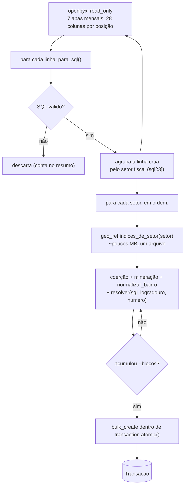

# Comando `carregar_itbi`

`python manage.py carregar_itbi --arquivo <planilha.xlsx>` lê a planilha de guias de
ITBI pagas e grava as transações no banco. É a **entrega demonstrável da fase de
dados**.

Junta as três peças que vêm antes: as funções puras de
[`carga-mineracao.md`](carga-mineracao.md), a
[referência geo versionada](referencia-geo.md) e o [modelo](modelo-transacao.md).
**Sem `pandas`, sem `shapely`.**

---

## Fluxo

**Por que agrupar por setor:** carregar a referência geo da cidade inteira custa
~450 MB (fica perto do teto de 600 MB do container). Carregando **um setor por
vez**, o pico cai para **~263 MB** — medido na carga completa das 7 abas (135.655
linhas, 170 s). O custo é reabrir 269 arquivos `.json.gz`; para uma carga que roda
poucas vezes por ano, compensa.

---

## Flags

| Flag | Efeito |
|---|---|
| `--arquivo` | **obrigatório**, o `.xlsx` |
| `--abas JAN-2026,FEV-2026` | só essas abas mensais (padrão: todas) |
| `--blocos N` | tamanho do `bulk_create` (padrão 2000) |
| `--limite N` | só as N primeiras linhas de cada aba (desenvolvimento) |
| `--limpar` | apaga **tudo** antes |
| `--substituir-mes` | apaga as linhas de cada `ano_guia`+`mes_guia` antes de reinserir — recarregar um mês não duplica |
| `--sem-geo` | não resolve `lat`/`lon`/`distrito` (tudo `--`) — feedback rápido |
| `--dry-run` | parseia, minera e valida sem gravar |

`carregar(arquivo, abas, ..., progresso=callback)` é uma função separada do
`Command` — é ela que a tela de admin vai reusar por trás de um upload assíncrono.

---

## Idempotência

Não há chave única natural (o mesmo imóvel transaciona mais de uma vez). O que
identifica "as linhas que vieram da aba `JUL-2026`" são os campos `ano_guia` /
`mes_guia` (o nome da aba, `MMM-YYYY`), **diferentes de `data_transacao`** (o mês do
negócio, que vai de 1994 a 2026). `--substituir-mes` apaga por
`(ano_guia, mes_guia)` e reinsere.

---

## Cobertura de geo

Na carga completa, **~1,7% das linhas ficam em `geo_nivel='--'`** (sem
correspondência na referência). A cauda está no mês mais recente — a referência foi
gerada de um *crawl* que ia até jun/2026, então quadras que só transacionaram em
julho ainda não estão nela. `scripts/prefetch_geo.py --refresh <setor>:<quadra>,...`
preenche. As linhas `--` **entram no banco** (não são puladas) — só não têm ponto no
mapa.
