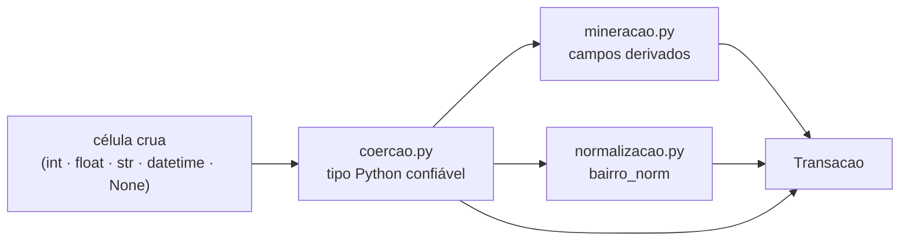
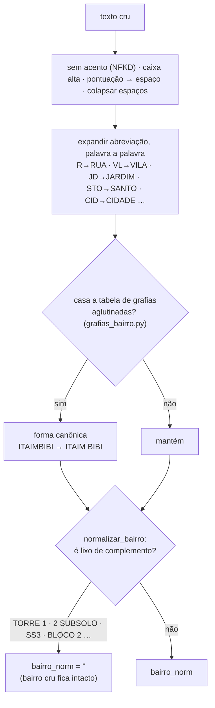
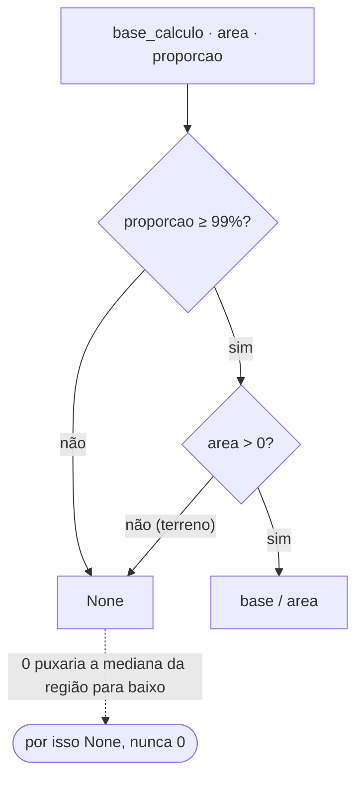

# SERA ATUALIAZADA POS V0

# Carga: coerção, normalização e mineração

A carga de ITBI abre a **planilha crua** (`.xlsx`, 7 abas, 28 colunas lidas por
posição) e minera no servidor, em streaming, sem `pandas` e sem `shapely`. Este
documento cobre a **lógica pura** que transforma uma linha da planilha nos campos do
modelo `Transacao` — as funções em `radar/carga/`.

> **Escopo:** `radar/carga/{coercao,normalizacao,grafias_bairro,mineracao}.py`. Nada
> de I/O, banco ou Django — a costura com o `openpyxl` e o `bulk_create` é o comando
> de carga em si. O `lat`/`lon`/`distrito` vêm de um _lookup_ separado
> ([`referencia-geo.md`](referencia-geo.md)). O esquema de destino está em
> [`modelo-transacao.md`](modelo-transacao.md).

---

## Ordem

Por que separado: cada módulo é testável isoladamente (65 testes puros, sem banco), e
**mudar uma regra depois de carregar obriga a recarregar tudo** — então tudo isto vem
antes da carga existir.

---

## `coercao.py` — célula → tipo Python

Uma célula do `openpyxl` chega como `int`, `float`, `str`, `datetime` ou `None`.

| Função                 | Devolve         | Trata                                                                                                                                     |
| ---------------------- | --------------- | ----------------------------------------------------------------------------------------------------------------------------------------- |
| `para_texto(v)`        | `str`           | `strip`; `None`/vazio → `''`                                                                                                              |
| `para_numero(v)`       | `float \| None` | número no formato **brasileiro** em texto (`'1.234,56'` → `1234.56`); texto não numérico → `None`                                         |
| `para_sql(v)`          | `str \| None`   | 11 dígitos com **zero à esquerda reconstruído** — a planilha traz o SQL como `int`, e `5202800061` é na verdade `05202800061` (setor 052) |
| `para_cep(v)`          | `str`           | 8 dígitos, zero à esquerda; `''` se vazio ou 0                                                                                            |
| `para_numero_porta(v)` | `str`           | sem zeros à esquerda; **`0` e `99999` são o código de "sem numeração"** → `''`; preserva `'71A'`                                          |
| `para_data(v)`         | `date \| None`  | no `.xlsx` já vem `datetime`; fallback de texto para outras origens                                                                       |
| `mes_guia(nome_aba)`   | `int \| None`   | `'MAR-2026'` → `3` — o mês do **pagamento da guia**, não o do negócio                                                                     |

---

## `normalizacao.py` — a chave de busca por bairro

Como o banco é SQLite, não há `unaccent` nem `pg_trgm`. A normalização acontece na
carga e o autocomplete roda sobre a lista de bairros já normalizados. O `bairro` cru
da planilha tem **8.368 grafias distintas** e vem **vazio em 40% das linhas**.

Três decisões, tomadas com o `scripts/analisar_bairros.py` sobre a extração de
27/08/2026:

- **A — expandir abreviação também em bairro.** `STO AMARO` e `SANTO AMARO` eram
  bairros diferentes; agora são um só. `S`→`SAO` ficou de fora (arriscado).
- **B — filtrar lixo de complemento.** ~8% das linhas preenchidas trazem `TORRE 1`,
  `2 SUBSOLO`, `SS3`, `BLOCO 2` no campo `bairro` (`TORRE 1` sozinho: 1.015 linhas).
  `normalizar_bairro` devolve `''` nesses casos — senão o autocomplete sugere "TORRE
  1" como se fosse um lugar. A regex é ancorada; nenhum bairro real casa. Ampliada
  depois de auditoria sobre a base completa (135.655 linhas): nome de prédio
  (`ED`/`ED.`/`EDIFICIO`) e depósito (`DEP ...`) entraram, mais o caso específico
  `DE FARIA ...` — fragmento de logradouro que vazou pro campo errado, 429
  ocorrências sozinho. Mediu 3.223 linhas a mais cobertas pela ampliação.
- **C — tabela de grafias aglutinadas** (`grafias_bairro.py`): 9 pares semeados
  (`ITAIMBIBI`, `VLFORMOSA`, `CASAVERDE`…), cresce à mão via o script.

| `bairro`                             | grafias distintas  |
| ------------------------------------ | ------------------ |
| cruas                                | **8.368**          |
| após `normalizar` + descarte de lixo | **7.148** (−14,6%) |

O campo continua alto-cardinalidade — é o "bairro" informal do IPTU, não os 96
distritos oficiais. A lista limpa de região vem do registro canônico
(`radar/regioes.py`, ver `docs/modelo-transacao.md`), a partir de `distrito` (geo).
`bairro_norm` é a chave familiar que o usuário digita, com match exato após
normalizar.

### API

| Função                           | Uso                                                                                   |
| -------------------------------- | ------------------------------------------------------------------------------------- |
| `normalizar(texto)`              | acento/caixa/pontuação/abreviação/tabela. Serve logradouro e bairro. `''` para vazio. |
| `eh_lixo_de_bairro(normalizado)` | `True` para `TORRE 1`, `2 SUBSOLO`…                                                   |
| `normalizar_bairro(texto)`       | `normalizar` + esvaziar o lixo. **É o que a carga grava em `bairro_norm`.**           |

---

## `mineracao.py` — campos derivados

Portado de `03_enriquecer.py` do projeto de referência. Recebe os campos crus já
coeridos, devolve os derivados.

| Função                                                       | Regra                                                                                                                                                                                                                                                      |
| ------------------------------------------------------------ | ---------------------------------------------------------------------------------------------------------------------------------------------------------------------------------------------------------------------------------------------------------- |
| `grupo_de_uso(uso_cod)`                                      | os ~37 códigos `uso` do IPTU em 11 grupos legíveis; código fora da tabela (a planilha tem `73` e `91`) → `"Outros"`                                                                                                                                        |
| `rs_m2_construido(base, area, proporcao)`                    | `base / area`, **só com `proporcao ≥ 99%`**; `area = 0` (terreno) → `None`. **Nunca `0`** — um zero contamina a mediana                                                                                                                                    |
| `rs_m2_terreno(base, area_terreno, proporcao, fracao_ideal)` | idem + `fracao_ideal ≥ 0,99` (num apartamento a área do lote é a do condomínio inteiro)                                                                                                                                                                    |
| `agio(valor, vvr_proporcional, proporcao)`                   | `valor / vvr`, **só com `proporcao ≥ 5%`** — abaixo disso a razão explode                                                                                                                                                                                  |
| `itbi_estimado(base)`                                        | `base × 0,03` — alíquota nominal, sem isenções                                                                                                                                                                                                             |
| `cod_natureza(texto)`                                        | `'1.Compra e venda'` → `1`                                                                                                                                                                                                                                 |
| `idade(acc)`                                                 | `2026 − acc`, ou `None` se implausível                                                                                                                                                                                                                     |
| `linha_deslocada(situacao_bruta, financ_bruto)`              | `True` quando um campo de texto veio como data/número — colunas escorregaram na planilha                                                                                                                                                                   |
| `valor_inconsistente(base, valor, vvr_proporcional)`         | `base ≠ max(declarado, VVR proporcional)` (tolerância R$ 1) — quase sempre base zerada com valor declarado                                                                                                                                                 |
| `valor_irrisorio(valor)`                                     | `valor < R$ 1.000` — pega taxa/parcela digitada no campo do imóvel mesmo quando o VVR "corrige" a base de cálculo e `valor_inconsistente` não pega nada (achado: 441 linhas, 258 delas com R$/m² calculado, 6 abaixo de R$ 100/m²)                        |
| `financiamento_incompativel(valor, valor_financiado)`        | `valor_financiado > valor` — mesmo sintoma do `valor_irrisorio`, capturável mesmo sem VVR                                                                                                                                                                  |
| `data_implausivel(data)`                                     | ano fora de `1990`–`ANO_BASE` — só erro de digitação óbvio (ex.: `2099`); contrato antigo regularizado tardiamente (visto até 1994) é legítimo e não entra aqui                                                                                            |
| `situacao_sql_invalida(situacao_sql)`                        | `True` para `"Cancelado Predial"` e `"Não_Existe_Exercício"` — a Prefeitura não reconhece mais aquele cadastro, então uso/área/padrão da linha não valem. `"Cancelado Territorial"` fica de fora (quase sempre lote-mãe subdividido pra empreendimento novo) |
| `qualidade(deslocada, inconsistente, irrisorio, financiamento_ruim, data_ruim, sql_ruim)` | `1·deslocada + 2·inconsistente + 4·irrisorio + 8·financiamento_ruim + 16·data_ruim + 32·sql_ruim` → `0` ok, `!= 0` sai do cálculo por padrão                                                                                     |
| `cadastro_defasado(natureza, financ, proporcao, uso_cod)`    | `True` quando o IPTU não acompanhou a realidade (compra e venda + financiamento habitacional + proporção pequena + `uso` de terreno/institucional). **Não reclassifica — só marca.** Detalhe e casos reais em [`modelo-transacao.md`](modelo-transacao.md) |
| `ano_transacao(data)` / `mes_transacao(data)`                | do `date`                                                                                                                                                                                                                                                  |

### A trava de proporção, visualmente

Sem a trava, o R$/m² de terreno medido na base dá **R$ 73/m²** em vez de **R$ 1.595\*\*.

Constantes: `ALIQUOTA_ITBI = 0.03`, `PROPORCAO_MIN_METRICA = 99.0`,
`FRACAO_MIN_TERRENO = 0.99`, `PROPORCAO_MIN_AGIO = 5.0`, `PROPORCAO_PEQUENA = 5.0`,
`ANO_BASE = 2026`, `VALOR_TRANSACAO_MINIMO = 1000`,
`ANO_TRANSACAO_MINIMO = 1990`, `ANO_TRANSACAO_MAXIMO = ANO_BASE`.

### Causa-raiz da coluna extra de FEV-2026

`carregar_itbi.py` lê 28 colunas por posição fixa porque a aba `FEV-2026` tem uma
coluna extra e o cabeçalho de uma delas vem com erro de digitação
(`Descrição do pardão (IPTU)`, sem o "r"). Auditoria sobre a base completa achou a
causa: a **linha 2.196** daquela aba tem a razão social de uma incorporadora
(`JAGUARIAIAVA DIALOGO EMPREENDIMENTOS IMOBILIARIOS`) vazada dentro da coluna
numérica `Valor de Transação` — isso empurrou todas as colunas daquela linha 4
posições à direita, e a aba inteira ganhou uma 29ª coluna fantasma pra acomodar o
desvio de uma única linha. `linha_deslocada` já detecta e marca essa linha via
`qualidade`; nada muda aqui, é só o registro do porquê.

---

## O que entra na mediana, e o que a tela diz sobre ela

A carga grava toda linha; quem decide o que entra no valor típico é
`radar/estatisticas.py`, na leitura. Nada abaixo exige recarregar o banco.

- **Só natureza de mercado.** `NATUREZAS_DE_MERCADO = (1, 2, 26, 35)`: compra e venda
  e as cessões de direitos de compra. Leilão, retomada do imóvel pelo banco, dação em
  pagamento, permuta, integralização de capital, sentença judicial e afins ficam fora
  do cálculo, porque o preço deles não é o de uma venda comum (o leilão fecha bem
  abaixo). É uma lista de inclusão: um código novo que apareça na planilha fica fora
  até alguém decidir. O filtro casa o prefixo **com o ponto** (`"1."`), para `1` não
  pegar `10.` ou `17.`. Essas linhas **continuam** na lista da região e na página da
  transação; a região informa quantas ficaram fora. Não viram bit de `qualidade`,
  porque a linha não tem defeito.
- **A referência da Prefeitura.** `base_calculo = max(valor declarado, VVR
  proporcional)`, e o R$/m² é calculado sobre a base. Quando o declarado ficou abaixo da
  referência, o número que entra na mediana é a referência, não o preço pago. O cálculo
  continua sobre a base (usar o declarado deixaria a mediana menor e mais suja de
  valores subdeclarados); a região mostra a proporção dessas vendas
  (`pct_pela_referencia`: `base_calculo > valor_transacao + 1` entre as linhas com VVR).
  Na periferia ela passa de 40%; nos distritos centrais fica perto de 15%.
- **Imóvel usado.** Unidade vendida em empreendimento novo não tem a área da unidade na
  guia (só o terreno, com proporção transmitida pequena), então não ganha R$/m² e não
  entra na mediana. A página da região diz isso.
- **Mês fraco na série.** A série mensal marca como pouco confiável o mês com menos de
  `LIMIAR_MES_FRACO = 10` vendas.
- **O degrau de janeiro.** A referência da Prefeitura é reajustada todo ano, e as vendas
  tributadas pela referência sobem junto. Por isso a série mensal dá um degrau de
  dezembro para janeiro que é, em boa parte, reajuste de tabela, não valorização. A
  série continua com a mesma definição da mediana; quem ler variação entre meses que
  cruzam janeiro precisa descontar isso.

---

## Como estender

| Mudança                            | Onde                                       | Cuidado                                                                       |
| ---------------------------------- | ------------------------------------------ | ----------------------------------------------------------------------------- |
| Novo par de grafia de bairro       | `grafias_bairro.py` (chave já normalizada) | rodar `scripts/analisar_bairros.py` para achar candidatos; a decisão é humana |
| Novo padrão de lixo de complemento | regex `_LIXO_BAIRRO` em `normalizacao.py`  | manter ancorada (`^…$`); conferir que nenhum bairro real casa                 |
| Novo código `uso` num grupo        | `_GRUPOS_USO` em `mineracao.py`            |                                                                               |
| Mudar um limiar de métrica         | as constantes de `mineracao.py`            | **obriga a recarregar o banco** — a métrica já está gravada nas linhas        |
| Nova abreviação                    | `_ABREVIACOES` em `normalizacao.py`        | age palavra a palavra; não separa forma colada (isso é a tabela de grafias)   |
