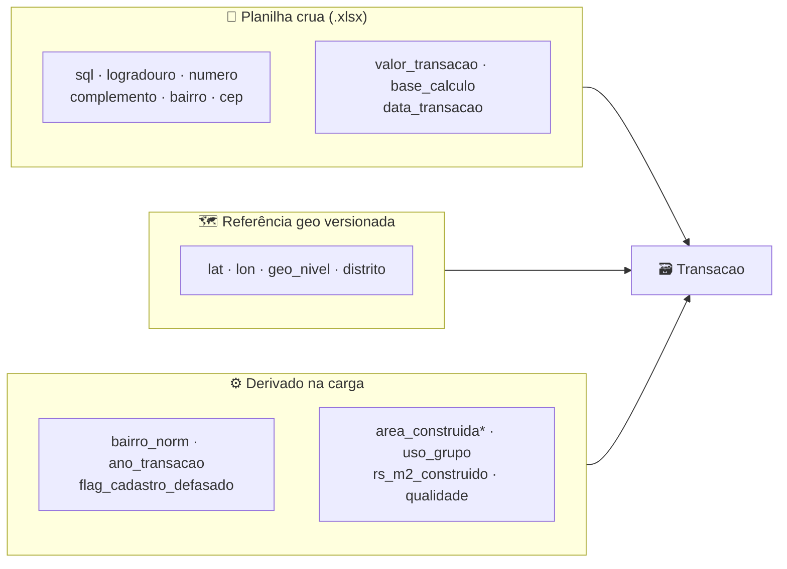
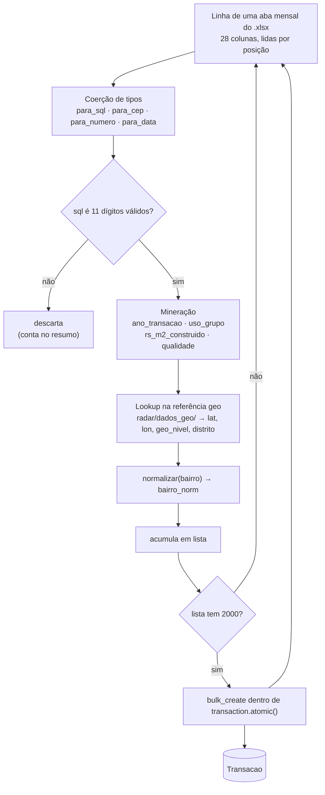
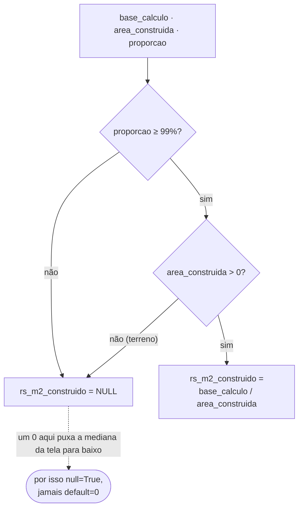
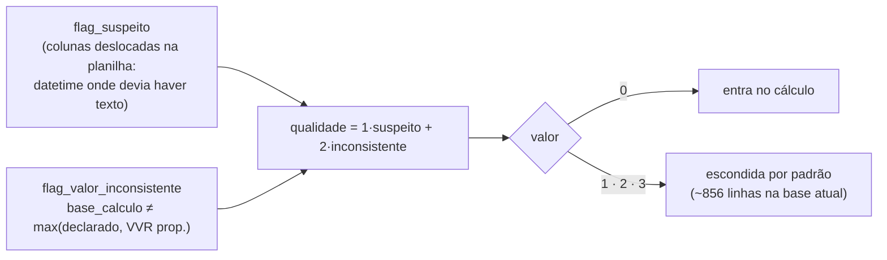
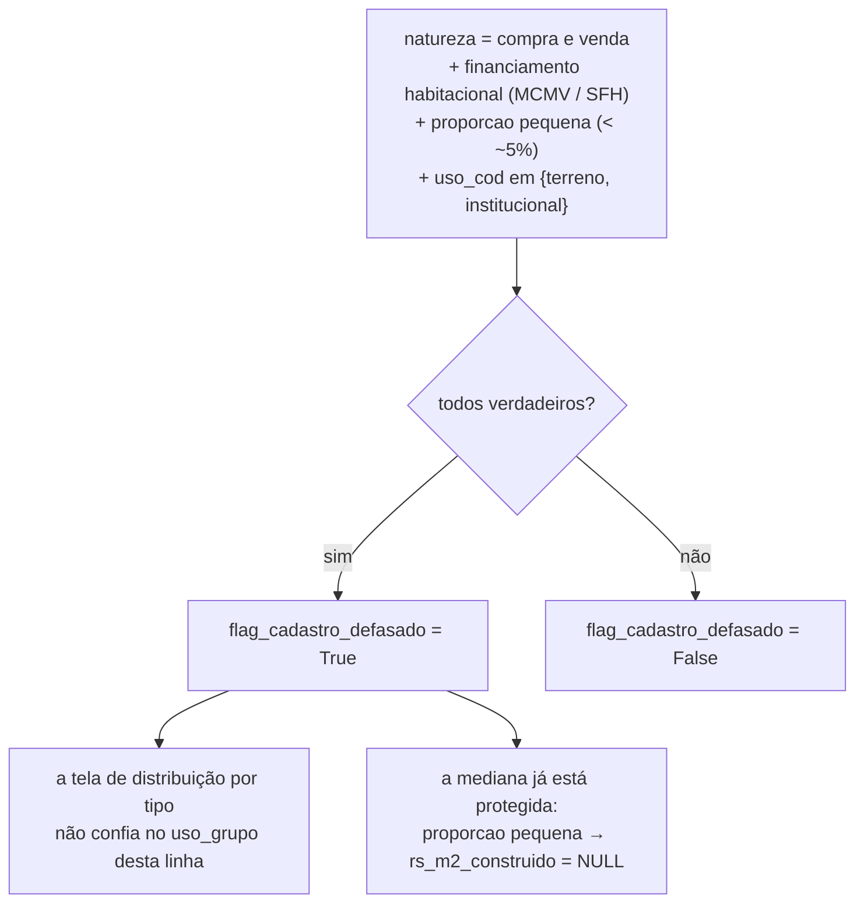
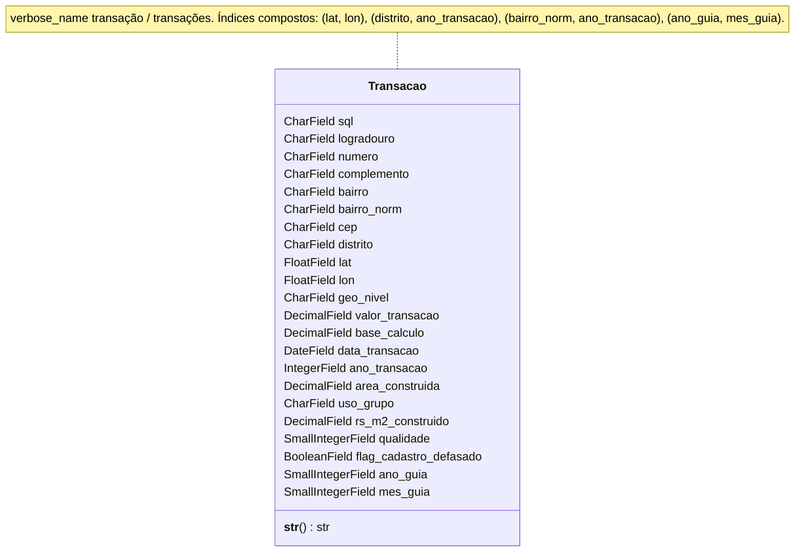

# Modelo `Transacao`

Documentação do esquema criado em `radar/models.py` — o modelo que sustenta todo o
resto do produto.

> **Escopo desta doc:** o modelo `Transacao` (migrations `0001` + `0002`). As regras
> que preenchem os campos derivados estão em
> [`carga-mineracao.md`](carga-mineracao.md); a geocodificação (`lat`, `lon`,
> `geo_nivel`, `distrito`), em [`referencia-geo.md`](referencia-geo.md); o comando
> que grava tudo, em [`carga-itbi.md`](carga-itbi.md).

---

## Por que ele existe

O produto responde a uma pergunta: *"o preço que estão me pedindo por este imóvel é
justo?"*. A resposta é a **mediana de R$/m² da região**, calculada sobre as
transações reais de ITBI. `Transacao` é uma linha dessas — um negócio registrado numa
guia de ITBI paga.

O modelo nasce **enxuto**: 22 campos, não as ~55 do dataset enriquecido do projeto de
referência. Entram agora só os campos que uma tela planejada consome, mais os que
existem porque **sem eles o número exibido está errado** (`ano_transacao`,
`qualidade`), porque o rótulo do imóvel não é confiável (`flag_cadastro_defasado`) ou
porque a carga precisa deles para ser idempotente (`ano_guia`, `mes_guia`) — e o
número é o produto. O resto entra por migration quando uma tela pedir
(`ALTER TABLE ADD COLUMN` é barato em SQLite; remover e renomear é que dói).

---

## De onde vem cada campo

Nenhuma linha chega pronta. Cada campo tem uma de três origens:

`*` `area_construida` vem crua da planilha, mas a carga decide entre `0` (terreno) e
`NULL`, então conta como "tratado".

---

## Campos

| Campo | Tipo | Nulo / vazio | Índice | Origem | Nota |
|---|---|---|---|---|---|
| `id` | `BigAutoField` | — | PK | — | chave sintética |
| `sql` | `CharField(11)` | obrigatório | — | planilha | cadastro do imóvel na Prefeitura; **não é único** (o mesmo imóvel transaciona mais de uma vez); vem como `int`, a carga faz `zfill(11)` |
| `logradouro` | `CharField(150)` | obrigatório | — | planilha | grafia abreviada do IPTU (`R `, `AV `); 100% preenchido na origem |
| `numero` | `CharField(10)` | obrigatório | — | planilha | texto, não `int`; `0` / `99999` na origem = sem numeração |
| `complemento` | `CharField(40)` | `blank=True` | — | planilha | unidade dentro do imóvel (`AP 614`, `BL. TC AP 614`); ~10% vazio; é o campo que denuncia venda de apartamento num SQL ainda cadastrado como terreno |
| `bairro` | `CharField(120)` | `blank=True` | — | planilha | grafia original do IPTU; **vem vazio em 40% das linhas** |
| `bairro_norm` | `CharField(120)` | `blank=True` | simples | derivado | sem acento, caixa única, grafias unificadas — é a chave de busca por bairro; vazio quando `bairro` é vazio |
| `cep` | `CharField(8)` | `blank=True` | simples | planilha | só dígitos, com zero à esquerda preservado; 99,998% preenchido |
| `distrito` | `CharField(60)` | `blank=True` | simples | geo | um dos 96 distritos oficiais; vazio quando não há coordenada |
| `lat` | `FloatField` | `null=True` | composto `(lat, lon)` | geo | |
| `lon` | `FloatField` | `null=True` | composto `(lat, lon)` | geo | |
| `geo_nivel` | `CharField(2)` | `blank=True` | — | geo | `T1` (lote exato) → `T4` (centroide da quadra, ~100 m), ou `--` sem coordenada |
| `valor_transacao` | `DecimalField(15, 2)` | obrigatório | — | planilha | valor declarado pelo contribuinte |
| `base_calculo` | `DecimalField(15, 2)` | obrigatório | — | planilha | base do ITBI = `max(declarado, VVR proporcional)`; ~1% vem `0` na origem |
| `data_transacao` | `DateField` | `null=True` | — | planilha | é `datetime` de verdade no `.xlsx` |
| `ano_transacao` | `IntegerField` | `null=True` | simples + composto | derivado | ano de `data_transacao`; **correção, não filtro** — ver abaixo |
| `area_construida` | `DecimalField(9, 2)` | `null=True` | — | planilha (tratado) | cap oficial 951.000 m²; `0` para terreno vira `0` ou `NULL` conforme a regra da métrica |
| `uso_grupo` | `CharField(40)` | `blank=True` | simples | derivado | agrupamento dos ~37 códigos `uso_cod` do IPTU (`"Apartamento / res. vertical"`, `"Terreno"`, …) |
| `rs_m2_construido` | `DecimalField(12, 2)` | `null=True` | — | derivado | R$/m² construído; **`null=True`, jamais `default=0`** — ver abaixo |
| `qualidade` | `SmallIntegerField` | `default=0` | simples | derivado | `0` = linha boa; `≠ 0` sai do cálculo por padrão — ver abaixo |
| `flag_cadastro_defasado` | `BooleanField` | `default=False` | — | derivado | `True` quando o cadastro do IPTU não acompanhou a realidade (SQL como terreno/institucional, mas a venda é de apartamento) — ver abaixo |
| `ano_guia` | `SmallIntegerField` | `null=True` | composto `(ano_guia, mes_guia)` | do nome da aba | ano em que a **guia** foi paga (a aba mensal da planilha) |
| `mes_guia` | `SmallIntegerField` | `null=True` | composto `(ano_guia, mes_guia)` | do nome da aba | mês da guia — **não** é `data_transacao` (o negócio pode ser de anos antes); é a chave da carga idempotente |

---

## Índices

São eles que substituem o PostgreSQL: não há `pg_trgm` nem `unaccent`, e a consulta
espacial é *bounding box*, não geometria. Dez ao todo (`0001` + `0002`).

| Índice | Colunas | Consulta que serve |
|---|---|---|
| `..._bairro_norm_...` | `bairro_norm` | autocomplete e busca por bairro |
| `..._cep_...` | `cep` | busca por CEP |
| `..._distrito_...` | `distrito` | agregação por distrito |
| `..._ano_transacao_...` | `ano_transacao` | recorte temporal |
| `..._uso_grupo_...` | `uso_grupo` | filtro por tipo de imóvel |
| `..._qualidade_...` | `qualidade` | esconder linhas ruins (quase toda consulta filtra `qualidade=0`) |
| `radar_trans_lat_lon` | `(lat, lon)` | pontos dentro da área visível do mapa |
| `radar_trans_distrito_ano` | `(distrito, ano_transacao)` | **a consulta da tela principal**: mediana da região num período |
| `radar_trans_guia` | `(ano_guia, mes_guia)` | `--substituir-mes` da carga (`0002`) |
| `radar_trans_bairro_ano` | `(bairro_norm, ano_transacao)` | idem, pela outra chave de busca |

Os seis simples nascem de `db_index=True` no campo; os quatro compostos, de
`Meta.indexes` com nome explícito.

---

## Fluxo de povoamento de uma linha

O modelo é o destino de um comando de carga que roda **no servidor**, em streaming,
sem `pandas` e sem `shapely` (ver [`carga-itbi.md`](carga-itbi.md)).

Idempotência: recarregar um mês já carregado **substitui** as linhas daquele
`mes_guia`+ano — não há chave única natural para deduplicar linha a linha.

---

## Regras de correção que o modelo protege

### 1. `rs_m2_construido` é `NULL`, nunca `0`

A base de cálculo se refere à **fração transmitida**; a área vem do cadastro do IPTU e
descreve o **imóvel inteiro**. Dividir uma pela outra só dá um R$/m² comparável quando
a transação é da totalidade.

Sem a trava, o R$/m² de terreno medido na base dá **R$ 73/m²** em vez de **R$ 1.595**.

### 2. `ano_transacao` é correção, não filtro avançado

A aba mensal da planilha é o mês em que **a guia foi paga**, não em que o negócio
aconteceu. As datas de transação da base vão de **1994 a 2026** (33 anos distintos;
96,5% é 2026, mas ~4.800 linhas são mais antigas).

Sem recortar por `ano_transacao`, a mediana de uma região mistura um negócio de 1998
com um de 2026 — e a mediana *é* o produto. Por isso ele entra no MVP e é indexado
junto com `distrito` e `bairro_norm`.

### 3. `qualidade` esconde as linhas que não fecham

Quase toda consulta do produto filtra `qualidade=0` — daí o índice.

### 4. `bairro` pode ser vazio; `cep` e `sql` não

40% das linhas da planilha não têm bairro. A chave de recuperação de endereço e de
geocodificação é `sql` + `cep` (100% e 99,998% preenchidos), não o bairro. `bairro` e
`bairro_norm` são `blank=True` de propósito.

### 5. `flag_cadastro_defasado`: o IPTU não acompanhou a realidade

O `uso_cod`/`padrao_cod` descrevem o imóvel **como o cadastro do IPTU o conhece** —
que nem sempre é como ele está hoje. Um terreno que virou prédio de apartamentos pode
continuar registrado como `TERRENO` (`area_construida = 0`, `situacao_sql = Ativo
Territorial`), e a venda de uma unidade aparece com `uso_grupo` "Terreno".

Dois casos reais na base:

| Sinal | R JORGE FARES 178 | R LUTECIA (s/nº) |
|---|---|---|
| `natureza` | compra e venda | compra e venda |
| `tipo_financiamento` | Minha Casa Minha Vida | Minha Casa Minha Vida |
| `proporcao` | 0,32% | 0,07% |
| `complemento` | 179 E 314 | BL. TC AP 614 |
| `uso` / `padrao` (IPTU) | 74 "outras edif." / 92 "templo, clube…" | 0 TERRENO / 00 TERRENO |
| `area_construida` | 650 (prédio antigo) | 0 |
| `qualidade` | 0 (os números do ITBI batem) | 0 |

**O que o flag NÃO faz:** não reclassifica o imóvel nem esconde a linha. A mediana de
R$/m² já está a salvo pela trava de proporção (regra 1) — essas vendas são sempre de
fração ínfima. O flag existe para a análise por tipo de imóvel poder separar o que o
cadastro rotula mal.

---

## O modelo, resumido

Anulável (`null=True`): `lat`, `lon`, `data_transacao`, `ano_transacao`,
`area_construida`, `rs_m2_construido`, `ano_guia`, `mes_guia`.
Pode ser vazio (`blank=True`): `complemento`, `bairro`, `bairro_norm`, `cep`,
`distrito`, `geo_nivel`, `uso_grupo`.
Indexado: `bairro_norm`, `cep`, `distrito`, `ano_transacao`, `uso_grupo`,
`qualidade`, mais os quatro compostos. `flag_cadastro_defasado` fica sem índice até
uma tela agregá-lo.

---

## Fora de escopo agora (entram por migration quando uma tela pedir)

`referencia`, `setor`, `quadra`, `lote`, `matricula`, `cartorio`, `situacao_sql`,
`natureza`, `natureza_cod`, `vvr`, `proporcao`, `vvr_proporcional`,
`tributado_por_vvr`, `itbi_estimado`, `tipo_financiamento`, `valor_financiado`,
`pct_financiado`, `area_terreno`, `testada`, `fracao_ideal`, `uso_cod`, `uso_desc`,
`padrao_cod`, `padrao_desc`, `padrao_nivel`, `acc`, `idade`, `rs_m2_terreno`, `agio`,
`mes_transacao`, `defasagem_dias`, `subprefeitura`, `regiao`,
`flag_suspeito`, `flag_transacao_antiga`, `flag_valor_inconsistente`.

> `proporcao`, `tipo_financiamento`, `natureza` e `uso_cod` **não** viram campo agora,
> mas a carga lê os quatro para derivar `flag_cadastro_defasado` e as métricas. O que
> não entra é o armazenamento, não a leitura.

## Como evoluir o esquema

1. Adicionar campo: `null=True` ou `default` sensato, `makemigrations`, `migrate`. Em
   SQLite com dado dentro isso é `ALTER TABLE ADD COLUMN` — barato.
2. **Nunca** `default=0` num campo de métrica (`rs_m2_*`, `agio`). Um teste
   (`tests/test_modelo_transacao.py`) falha se isso reaparecer.
3. Índice novo entra em `Meta.indexes` com `name=` explícito (limite de 30 caracteres
   no SQLite via Django).
