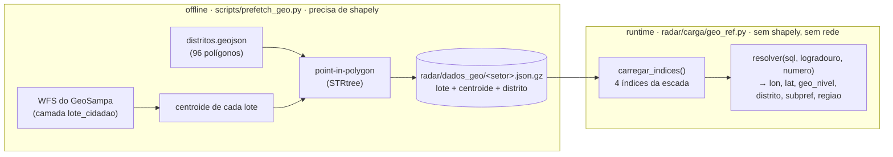

# SERA ATUALIAZADA POS V0

# Referência geo versionada

A planilha do ITBI **não traz coordenada**. A única chave espacial é o `sql` (setor
3 + quadra 3 + lote 4 + dígito) e o endereço. Este documento cobre como a carga
resolve `lat`/`lon`/`distrito` **sem chamar o GeoSampa e sem `shapely` em runtime**.

---

## A ideia

O trabalho pesado (baixar os polígonos dos lotes do GeoSampa, calcular centroide,
descobrir o distrito de cada um por _point-in-polygon_) roda **uma vez, offline**, e o
resultado é **versionado** em `radar/dados_geo/`. Em runtime a carga só faz _lookup_.



Lote/quadra que não estiver na referência → `geo_nivel = '--'`, e um _refresh_ offline
preenche a lacuna depois.

---

## `radar/dados_geo/` — o artefato versionado

Um arquivo por setor fiscal, `gzip` + JSON colunar:

```
radar/dados_geo/<setor>.json.gz  →  {"lotes": [[quadra, lote, cond, logr_norm,
                                                num_norm, lon, lat, distrito,
                                                subpref, regiao], ...]}
radar/dados_geo/_meta.json       →  data do prefetch, origem, contagens
```

Estado atual (bootstrap a partir do cache do projeto de referência, mais um
`--refresh` com as quadras que faltavam para as planilhas de 2025 e 2026):

|                  | bootstrap | depois do _refresh_ |
| ---------------- | --------- | ------------------- |
| setores          | 269       | 284                 |
| lotes            | 739.789   | 1.118.342           |
| tamanho em disco | ~13 MB    | ~19 MB              |

O `_meta.json` não é reescrito num _merge_ — continua descrevendo o bootstrap.

`logr_norm` e `num_norm` passam pelas **mesmas** funções que a carga usa no lado da
planilha (`radar.carga.normalizacao.normalizar`, `coercao.para_numero_porta`), então
os dois lados casam.

---

## A escada de resolução (`geo_ref.resolver`)

| Nível    | Como resolve                                             | Precisão                                                                            |
| -------- | -------------------------------------------------------- | ----------------------------------------------------------------------------------- |
| **T1**   | `sql` bate lote a lote (setor + quadra + lote)           | centroide do lote                                                                   |
| **T2**   | endereço (logradouro + número) dentro da quadra          | resolve apartamento em condomínio, cujo SQL de unidade não existe em `lote_cidadao` |
| **T3**   | mesmo logradouro na quadra, número de porta mais próximo | vizinhança                                                                          |
| **T4**   | centroide de todos os lotes da quadra fiscal             | ~100 m                                                                              |
| **`--`** | sem correspondência                                      | —                                                                                   |

`distrito` sai junto, já resolvido no _prefetch_: em T1 é o do próprio lote; em T2–T4
é a **maioria** entre os lotes que contribuíram (na escala de uma quadra a diferença
entre lotes vizinhos é menor que o próprio distrito).

### Custo de memória

`carregar_indices()` (a cidade inteira) monta ~1,4 M de entradas em quatro
dicionários: **~450 MB de pico**, perto do teto de 600 MB do container. Por isso a
carga **não usa** essa função — usa `indices_de_setor(setor)`, que lê um arquivo só
(~poucos MB), processando as transações **agrupadas por setor**. Pico da carga
completa: **~245 MB**. `carregar_indices()` fica para testes e uso pontual.

---

## `scripts/prefetch_geo.py` — offline

Precisa de `shapely` (`requirements-geo.txt`, **nunca** em `requirements.txt`).

| Modo                         | O que faz                                                                                                                |
| ---------------------------- | ------------------------------------------------------------------------------------------------------------------------ |
| `--cache <pasta>`            | bootstrap de um cache já baixado (formato do projeto de referência), **sem rede** — é como `radar/dados_geo/` foi gerado |
| `--planilha <xlsx>`          | _crawl_ do GeoSampa para os setores/quadras que aparecem na planilha                                                     |
| `--cidade-inteira`           | _crawl_ de todos os setores fiscais (exige a lista de setores)                                                           |
| `--refresh SETOR:QUADRA,...` | baixa só o que falta e faz _merge_ no `radar/dados_geo/` existente                                                       |

O script não é executável: rode com o Python do venv, que precisa ter o `shapely`
(`venv/bin/python scripts/prefetch_geo.py ...`).

> **`--planilha` sobrescreve, `--refresh` acrescenta.** O modo `--planilha` reescreve o
> arquivo de cada setor **só** com as quadras daquela planilha — os lotes que vieram de
> outras planilhas nesses setores somem. Para completar a referência existente, use
> sempre `--refresh`. (No `--refresh`, um setor que falhar no WFS fica como estava.)

O _crawl_ completo da cidade ainda não rodou — o bootstrap cobre os setores/quadras
que transacionaram até jul/2026. Mês novo com quadra nova cai em `--` até um
`--refresh`. Chamar o WFS em runtime (em vez de manter a referência versionada) está
anotado como plano futuro.

### Completar a referência para uma planilha nova

Uma linha só fica `--` quando **a quadra inteira** não está na referência (se a quadra
existe, a escada chega pelo menos a T4). Então a lista de `SETOR:QUADRA` a baixar é
exatamente a das linhas que dão `--`:

```bash
venv/bin/python - <<'EOF'
import openpyxl
from radar.carga import coercao, geo_ref
arq = "tmp/<planilha>.xlsx"
wb = openpyxl.load_workbook(arq, read_only=True, data_only=True)
por_setor = {}
for aba in (a for a in wb.sheetnames if len(a) == 8 and a[3] == "-"):
    for r in wb[aba].iter_rows(min_row=2, values_only=True):
        if sql := coercao.para_sql(r[0]):
            por_setor.setdefault(sql[:3], []).append((sql, r[1], r[2]))
faltam = set()
for setor, itens in por_setor.items():
    idx = geo_ref.indices_de_setor(setor)
    faltam |= {f"{s[:3]}:{s[3:6]}" for s, logr, num in itens
               if geo_ref.resolver(s, logr, num, idx)[2] == "--"}
open("tmp/quadras-sem-geo.txt", "w").write(",".join(sorted(faltam)))
print(len(faltam), "quadras")
EOF

venv/bin/python scripts/prefetch_geo.py --refresh "$(cat tmp/quadras-sem-geo.txt)" 2>&1 | tee tmp/prefetch.log
```

Para mais de uma planilha, junte as listas numa só (um `set`) e rode um `--refresh`.
As linhas `--` de um mês **já carregado** também dão a lista direto do banco:
`Transacao.objects.filter(geo_nivel="--").values_list("sql", flat=True)`.

Depois: `carregar_itbi --arquivo <planilha> --dry-run` para conferir que o `sem geo`
caiu, commit de `radar/dados_geo/`, deploy, e só então a carga — **inclusive recarregar
os meses já no banco** que tinham linhas `--`, porque o geo fica gravado na linha.

**O que o `--refresh` não muda:**

- **Lotes que já estão na referência.** O _merge_ só acrescenta `(quadra, lote)` que
  ainda não existe, e as quadras da lista são justamente as ausentes — nenhuma quadra
  já presente ganha ou perde lote.
- **Transações já gravadas no banco.** `lat`/`lon`/`distrito` são resolvidos **na
  carga** e gravados na linha. Mudar `radar/dados_geo/` não mexe em nada que já foi
  carregado; um mês antigo só aproveita a referência nova se for recarregado
  (`--substituir-mes`).
- **A geometria vem do cadastro atual**, não do ano da planilha: o WFS devolve o lote
  como ele é hoje. Não existe "referência de 2025" separada da de 2026.

**Cobertura medida** (`carregar_itbi --dry-run`), antes e depois do _refresh_:

| planilha                      | linhas  | `--` antes          | `--` depois       |
| ----------------------------- | ------- | ------------------- | ----------------- |
| 2025 (extração de 28/01/2026) | 230.525 | 24.747 (10,7%)      | **1.274 (0,55%)** |
| 2026 (extração de 27/08/2026) | 135.655 | 2.253 (1,7%)        | **440 (0,32%)**   |

Na de 2025 faltavam 10.105 quadras de 279 setores — o bootstrap veio das quadras que
transacionaram em 2026. Na de 2026, o que caiu foi julho (1.882 → 69), a cauda que o
_crawl_ original não alcançava; jan–jun ficaram iguais. O `--` que sobra é de quadra
que o próprio WFS não devolveu: rodar o `--refresh` de novo não muda.

O _merge_ foi conferido contra a versão commitada: os 739.789 registros antigos
continuam presentes, idênticos e na mesma ordem — só entraram registros no fim de cada
arquivo e 15 setores novos. (Contar por `(quadra, lote)` dá falso "alterado": unidades
de condomínio repetem a chave, 26.716 casos.)
