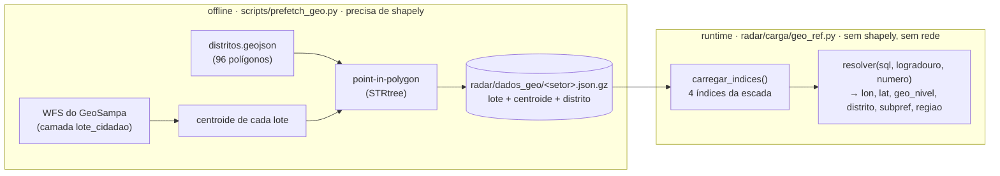

# SERA ATUALIAZADA POS V0

# Referência geo versionada

A planilha do ITBI **não traz coordenada**. A única chave espacial é o `sql` (setor
3 + quadra 3 + lote 4 + dígito) e o endereço. Este documento cobre como a carga
resolve `lat`/`lon`/`distrito` **sem chamar o GeoSampa e sem `shapely` em runtime**.

---

## A ideia

O trabalho pesado (baixar os polígonos dos lotes do GeoSampa, calcular centroide,
descobrir o distrito de cada um por _point-in-polygon_) roda **uma vez, offline**, e o
resultado é **versionado** em `radar/dados_geo/`. Em runtime a carga só faz _lookup_.



Lote/quadra que não estiver na referência → `geo_nivel = '--'`, e um _refresh_ offline
preenche a lacuna depois.

---

## `radar/dados_geo/` — o artefato versionado

Um arquivo por setor fiscal, `gzip` + JSON colunar:

```
radar/dados_geo/<setor>.json.gz  →  {"lotes": [[quadra, lote, cond, logr_norm,
                                                num_norm, lon, lat, distrito,
                                                subpref, regiao], ...]}
radar/dados_geo/_meta.json       →  data do prefetch, origem, contagens
```

Estado atual (bootstrap a partir do cache do projeto de referência):

|                    |            |
| ------------------ | ---------- |
| setores            | 269        |
| lotes              | 739.789    |
| lotes sem distrito | 93 (0,01%) |
| tamanho em disco   | ~13 MB     |

`logr_norm` e `num_norm` passam pelas **mesmas** funções que a carga usa no lado da
planilha (`radar.carga.normalizacao.normalizar`, `coercao.para_numero_porta`), então
os dois lados casam.

---

## A escada de resolução (`geo_ref.resolver`)

| Nível    | Como resolve                                             | Precisão                                                                            |
| -------- | -------------------------------------------------------- | ----------------------------------------------------------------------------------- |
| **T1**   | `sql` bate lote a lote (setor + quadra + lote)           | centroide do lote                                                                   |
| **T2**   | endereço (logradouro + número) dentro da quadra          | resolve apartamento em condomínio, cujo SQL de unidade não existe em `lote_cidadao` |
| **T3**   | mesmo logradouro na quadra, número de porta mais próximo | vizinhança                                                                          |
| **T4**   | centroide de todos os lotes da quadra fiscal             | ~100 m                                                                              |
| **`--`** | sem correspondência                                      | —                                                                                   |

`distrito` sai junto, já resolvido no _prefetch_: em T1 é o do próprio lote; em T2–T4
é a **maioria** entre os lotes que contribuíram (na escala de uma quadra a diferença
entre lotes vizinhos é menor que o próprio distrito).

### Custo de memória

`carregar_indices()` (a cidade inteira) monta ~1,4 M de entradas em quatro
dicionários: **~450 MB de pico**, perto do teto de 600 MB do container. Por isso a
carga **não usa** essa função — usa `indices_de_setor(setor)`, que lê um arquivo só
(~poucos MB), processando as transações **agrupadas por setor**. Pico da carga
completa: **~245 MB**. `carregar_indices()` fica para testes e uso pontual.

---

## `scripts/prefetch_geo.py` — offline

Precisa de `shapely` (`requirements-geo.txt`, **nunca** em `requirements.txt`).

| Modo                         | O que faz                                                                                                                |
| ---------------------------- | ------------------------------------------------------------------------------------------------------------------------ |
| `--cache <pasta>`            | bootstrap de um cache já baixado (formato do projeto de referência), **sem rede** — é como `radar/dados_geo/` foi gerado |
| `--planilha <xlsx>`          | _crawl_ do GeoSampa para os setores/quadras que aparecem na planilha                                                     |
| `--cidade-inteira`           | _crawl_ de todos os setores fiscais (exige a lista de setores)                                                           |
| `--refresh SETOR:QUADRA,...` | baixa só o que falta e faz _merge_ no `radar/dados_geo/` existente                                                       |

O _crawl_ completo da cidade ainda não rodou — o bootstrap cobre os setores/quadras
que transacionaram até jul/2026, que é quase toda a cidade. Mês novo com quadra nova
cai em `--` até um `--refresh`. Chamar o WFS em runtime (em vez de manter a referência
versionada) está anotado como plano futuro.
